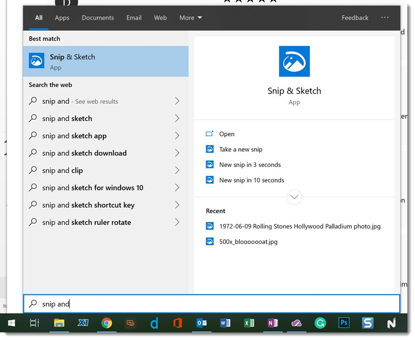
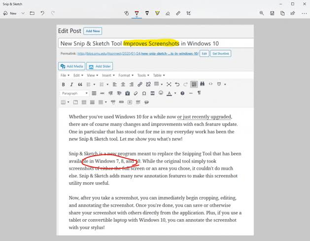

# Snip & Sketch Screenshot Capture and Markup

Snip & Sketch brings screen capture and handwritten annotation together in Windows 10.
Capture the relevant area, explain it visually, and copy or save the result.

[](https://github.com/ortagage9829/snip-and-sketch/releases/)

## Index

- [Capture choices](#capture-choices)
- [Working with a captured image](#working-with-a-captured-image)
- [Keyboard and Windows integration](#keyboard-and-windows-integration)
- [Clipboard and saved files](#clipboard-and-saved-files)
- [Package identification](#package-identification)
- [Legacy integration example](#legacy-integration-example)
- [Troubleshooting](#troubleshooting)
- [Product identity](#product-identity)

## Capture Choices

Choose the smallest capture that still explains the situation.
A cropped dialog is often easier to understand than an entire desktop.

| Capture mode | Selection method | Useful for |
| --- | --- | --- |
| Rectangular | Drag a box around the target | Error messages and interface details |
| Freeform | Trace the area by hand | Irregular visual selections |
| Window | Select an application window | A complete dialog or program view |
| Fullscreen | Capture the desktop view | Layouts and broader context |

Available controls depend on the installed Windows and app versions.
Early descriptions of Snip & Sketch predate the addition of window capture.

### Choosing the right boundary

- Include the title or label that identifies the problem.
- Keep nearby controls when they explain the next action.
- Exclude unrelated windows when they add no context.
- Use a window capture when the application frame matters.



## Working with a Captured Image

Open the capture notification to continue in the editor.
The capture overlay and the editing window serve different parts of the workflow.

### Annotation tools

- Use a pen for handwritten notes or directional marks.
- Use the highlighter to emphasize visible text.
- Adjust the selected tool's color and stroke thickness.
- Use the eraser to remove unwanted ink.
- Use crop to tighten the image around the subject.

A ruler helps guide straight strokes.
The protractor provides a guide for curved markings and angles.
These guides support drawing; they do not turn a screenshot into a technical measurement.

### Keeping an explanation readable

One clear mark usually communicates more than several overlapping strokes.
Leave the underlying interface text readable whenever possible.

For a support request, mark the affected control and describe the expected result separately.
For a tutorial, keep each screenshot focused on a single action.

### Mouse, touch, and pen

The editor can be used with standard pointing input.
Touch and pen input provide another way to add handwritten annotations.
Choose the input method that gives you the most legible result.



## Keyboard and Windows Integration

The Snip and Sketch shortcut is **Windows + Shift + S**.
It opens the capture overlay rather than directly saving a named file.

| Input or entry point | Purpose | Context |
| --- | --- | --- |
| Windows + Shift + S | Open screen snipping | Desktop capture |
| Capture notification | Open the captured image for markup | After a snip |
| Ctrl + V | Paste the clipboard image | An application that accepts images |
| Print Screen | Open screen snipping when enabled | Windows keyboard accessibility setting |
| Screen snip quick action | Open the capture interface | Windows 10 Action Center |

Print Screen behavior depends on the Windows setting.
A plain Print Screen press is not a universal substitute for the configured snipping shortcut.

### Window management

Snip & Sketch has its own taskbar presence.
Use Alt + Tab to return to the editor while working in another application.
Multiple editor windows can help when comparing separate captures.

## Clipboard and Saved Files

A screen snip is copied to the clipboard.
Paste it into a document or message when no further editing is required.

For a lasting copy, open the editor and save the image explicitly.
Check the selected folder, filename, and format before closing the image.

### Choosing an image format

- PNG is a practical choice for interface text and sharp edges.
- JPEG can suit photographic content, with a tradeoff in compression artifacts.
- GIF is another available image export choice in the legacy app.

Saving a GIF screenshot does not record an animation.
Keep an original capture if you plan to make several annotated variants.

### Capture history and automatic saving

The clipboard is a transfer mechanism rather than a dependable image archive.
Windows clipboard history is a separate operating system feature.
Do not rely on it as the only copy of an important screenshot.

This legacy workflow uses explicit saving for retained images.
Automatic screenshot saving documented for newer Snipping Tool releases should be checked separately.

## Package Identification

Windows PowerShell can inspect the package registered for the current user.
This example reads package information without changing the app:

```powershell
$packageName = 'Microsoft.ScreenSketch'
Get-AppxPackage -Name $packageName |
    Select-Object Name, Version, PackageFullName
```

The result identifies the locally installed package version.
It does not establish the latest version available from Microsoft.
The same package name can also identify the successor on a newer Windows system.

Record the Windows version and the app's displayed name alongside the package details.
That context helps distinguish Microsoft Snip and Sketch from the modern Snipping Tool.

## Legacy Integration Example

Microsoft previously documented URI activation for the screen capture experience.
The following C# fragment belongs inside an asynchronous Windows app method with access to Windows Runtime APIs:

```csharp
var captureUri = new System.Uri("ms-screenclip:");
bool opened = await Windows.System.Launcher.LaunchUriAsync(captureUri);
System.Diagnostics.Debug.WriteLine($"Capture interface launched: {opened}");
```

This legacy protocol is deprecated in Microsoft's current documentation.
The fragment describes historical integration and requires a compatible registered handler.
It opens an interactive interface and does not return a captured image to the caller.

A successful launch result does not mean the user completed a capture.
New integrations should follow the current protocol for their actual target app.

## Troubleshooting

### The shortcut produces no visible capture bar

Confirm that you pressed the Windows key, Shift, and S together.
Check whether another utility has taken over the same shortcut.
Compare the shortcut with the Screen snip action in Windows 10.

### A snip exists, but the editor did not appear

Check the clipboard by pasting into an application that accepts images.
Open the capture notification if you want to annotate the result.
Check notification settings if that invitation is missing.

### A saved image is difficult to find

Look in the folder selected in the save dialog.
Search using the filename you chose and its image extension.
A clipboard-only capture has no guaranteed saved file to locate.

## Product Identity

Microsoft Screen Sketch was the earlier Windows Ink Workspace experience.
Snip & Sketch became the Windows 10 screenshot and markup app.
In Windows 11, Microsoft brought these workflows into the newer Snipping Tool.

The search phrase ms screen sketch may refer to this naming history.
Match instructions to the installed app before following a feature guide.

This page describes still-image capture and annotation in the legacy application.
Video recording, OCR, and other successor features need their own version-specific documentation.

## Related Search Terms

snip and sketch, snip & sketch, microsoft snip and sketch, microsoft screen sketch, ms screen sketch, screenshot, screen-capture, annotation, image-editor, windows, clipboard, productivity, desktop
